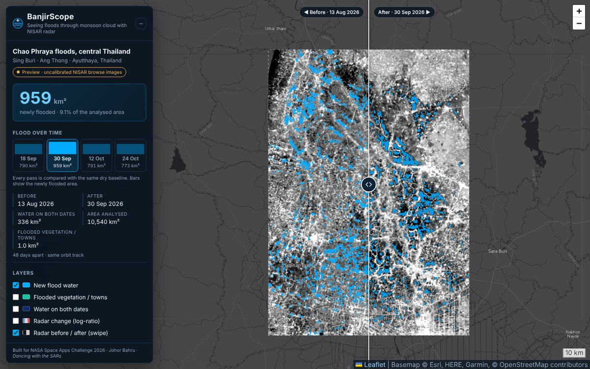
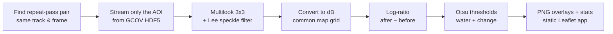
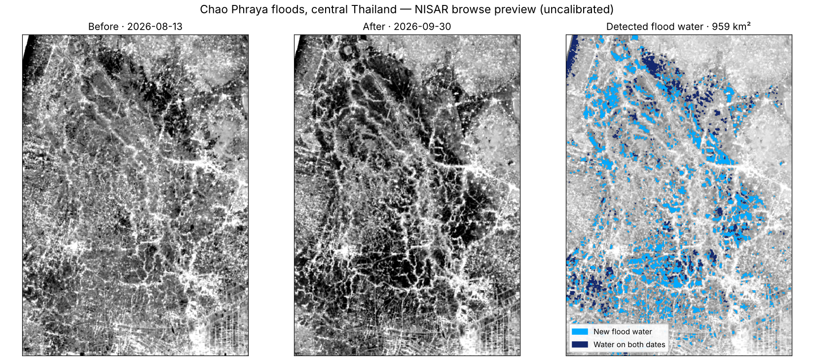
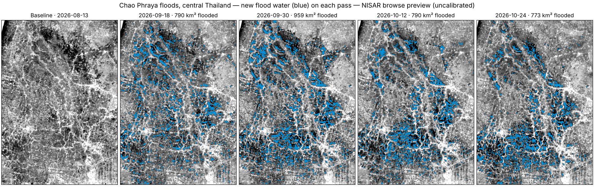

# BanjirScope: seeing floods through monsoon cloud with NISAR radar

*Banjir* is Malay for "flood". BanjirScope maps flood water from **NASA-ISRO NISAR** L-band radar and shows it on an interactive web map: before/after swipe, a flood mask, the flooded area in km², and a timeline that follows the flood across successive radar passes.

Built for the **NASA Space Apps Challenge 2026** (Johor Bahru local event), challenge *"Dancing with the SARs"*.



**Live demo:** https://n7wl.github.io/banjirscope/ · **Demo video (27 s):** [docs/demo/BanjirScope-demo.mp4](docs/demo/BanjirScope-demo.mp4) · **Slides:** [docs/demo/BanjirScope-demo.pdf](docs/demo/BanjirScope-demo.pdf)

---

## The problem

Every northeast monsoon (November to March), floods displace tens of thousands of people across Malaysia and its neighbours. Emergency teams need flood maps fast, but the same clouds that bring the rain block optical satellites such as Landsat and Sentinel-2. During the worst days of a flood, optical images often show nothing but cloud.

**Radar doesn't have that problem.** A synthetic aperture radar (SAR) sends its own microwave pulses and records the echo, so it works through cloud, rain and darkness. NISAR, launched in 2025, images almost all of Earth's land every 12 days with an L-band (24 cm wavelength) radar, and its data is free.

## How it works



1. **Pick a fair pair.** Radar brightness depends on the viewing angle, so both images must come from the same orbit track, frame and flight direction. `find_scenes.py` groups NISAR products into these repeat-pass "stacks".
2. **Read only what we need.** A GCOV frame is about 6.6 GB. HDF5 stores images in chunks, so the pipeline streams only the chunks covering the area of interest over HTTPS (byte-range requests).
3. **Clean the speckle.** Radar images are grainy because each pixel adds up echoes from many small scatterers. We average 3×3 pixels ("multilooking", 10 m → 30 m) and apply a **Lee filter**, which smooths flat areas but keeps edges sharp. Both steps work on linear power, because speckle is multiplicative.
4. **Compare in log space.** Calm water reflects the pulse away from the satellite like a mirror, so it looks black. The **log-ratio** `10·log10(after / before)` (a difference in dB) cancels effects common to both dates and makes newly flooded land stand out as strongly negative values.
5. **Let the data choose the thresholds.** **Otsu's method** finds the thresholds that best separate the modes of a histogram:
   - *Water threshold:* three-class Otsu on the flood-date image (water / fields / towns and trees). The lowest threshold separates water from land.
   - *Change threshold:* among pixels that are water on the flood date, permanent water barely changes while new flood water darkened a lot. Two-class Otsu on their log-ratio splits the two groups.
   - A pixel is **flooded** if it is water now, was not water before, and darkened past the change threshold. A morphological opening and a minimum-area filter (OpenCV) remove leftover noise.
6. **Follow the flood over time.** NISAR passes over the same track every 12 days, so an event can list several flood dates. Each one is compared with the *same* dry baseline on the *same* grid, with its own Otsu thresholds, and all images share one brightness stretch so they can be compared by eye. The app shows a chip per date with a bar for its flooded area.
7. **Look for water under trees and between buildings.** L-band passes through canopies. Where water stands under trees or between houses, the pulse bounces off the flat water, then off a trunk or wall, and straight back to the satellite ("double bounce"), so these places get *brighter* instead of darker. A separate layer flags pixels that were already bright before (the towns/trees class of a three-class Otsu on the dry-date image), brightened past a rise threshold (Otsu on the positive log-ratios, never below +3 dB) and lie within 1 km of open flood water. It is reported separately as `flooded_vegetation_km2`; the headline flooded area stays open water only.
8. **Publish as plain files.** Results are exported as transparent PNG overlays plus a `meta.json` with bounds and statistics. The web app is one static page, so it runs on GitHub Pages with no backend.

Flooded area is computed on the ground, correcting for Web-Mercator's stretch (pixel side × cos(latitude)).

## Showcase event: central Thailand, September 2026

Malaysia has excellent NISAR coverage (a pass every 12 days over every state since June 2026). However, the 2026 northeast monsoon only began on 27 October, and the October–November floods in Kedah, Perak and Selangor were small or not yet processed into the archive. The showcase therefore uses the large **Chao Phraya floodplain floods in central Thailand** (late September – early October 2026). It's a neighbouring country with the same monsoon flood problem. Adding a Malaysian event takes one config file (see [Add a new flood event](#add-a-new-flood-event)).

| | |
|---|---|
| Area | Sing Buri · Ang Thong · Ayutthaya (100.0–100.8°E, 14.2–15.3°N) |
| Stack | NISAR track 4, frame 81, descending, HH polarisation |
| Before | 13 Aug 2026 — `NISAR_L2_PR_GCOV_028_004_D_081_4005_DHDH_A_20260813T114712_…` |
| After | 30 Sep 2026 — `NISAR_L2_PR_GCOV_032_004_D_081_4005_DHDH_A_20260930T114712_…` |
| Result (calibrated NISAR L2 GCOV, 30 m) | **≈ 1,334 km² newly flooded** on 30 Sep (12.6% of the 10,540 km² analysed) |
| Flooded vegetation / towns | < 1 km² flagged next to open flood water (the layer is deliberately strict) |



**Timeline.** Four passes of the same stack, each compared with the 13 Aug baseline:

| Pass | 18 Sep | 30 Sep | 12 Oct | 24 Oct |
|---|---|---|---|---|
| Newly flooded | 484 km² | **1,334 km²** | 1,153 km² | 1,028 km² |



The flood builds through mid-September, peaks on 30 September and then recedes slowly: by late October the northern plain (Sing Buri) has largely drained, while water still stands downstream around Ayutthaya.

**How robust is the peak number?** On 30 Sep the backscatter histogram has a clear water mode near −19 dB and a land mode near −7 dB; the three-class Otsu water threshold (−14.3 dB) sits in the valley between them. Requiring water to be darker than a stricter −18 dB (with the same > 6 dB drop) still gives about 1,200 km², so the peak flooded area is roughly **1,200–1,330 km²** for any reasonable threshold.

> **Calibrated vs preview.** These numbers come from calibrated **GCOV γ⁰ backscatter** (radiometrically terrain-corrected, multilooked to 30 m), streamed with a NASA Earthdata token. The pipeline also has a *preview mode* that runs on ASF's free, uncalibrated browse images (~150 m) for quick checks without a login; it gave ≈ 960 km² for 30 Sep, which shows why calibrated data matters. The 24 Oct scene comes from a newer NISAR processing release (CRID P05036 vs P05023), so small calibration differences are possible for that date.

## NASA data used

- **NISAR L2 GCOV** (Geocoded Polarimetric Covariance): radiometrically terrain-corrected L-band backscatter on a UTM grid. [Product guide (ASF)](https://nisar-docs.asf.alaska.edu/gcov/) · [Product specification (JPL D-102274)](https://nisar.asf.earthdatacloud.nasa.gov/NISAR-SAMPLE-DATA/DOCS/NISAR_D-102274_RevE_NASA_SDS_Product_Specification_L2_GCOV_Nov8_2024_w-sigs.pdf)
- Archive and search: [ASF Vertex](https://search.asf.alaska.edu/) (dataset *NISAR*, product *GCOV*) via the [`asf_search`](https://github.com/asfadmin/Discovery-asf_search) Python package
- Mission: [NASA NISAR](https://science.nasa.gov/mission/nisar/)
- Event context: [NASA Earth Observatory: Floodwaters Overwhelm Thailand](https://science.nasa.gov/earth-observatory/floodwaters-overwhelm-thailand)

## Project structure

```
├── events/                      one JSON config per flood event (AOI, scenes, settings)
├── floodmap/                    Python package
│   ├── io_gcov.py               stream/subset NISAR GCOV HDF5 (Earthdata token)
│   ├── io_preview.py            free browse-image stand-in ("preview mode")
│   ├── processing.py            multilook, Lee filter, dB, Web-Mercator resampling
│   ├── detection.py             log-ratio + Otsu flood detection, flooded vegetation, cleanup, area
│   ├── timeline.py              multi-date events: flood dates, shared display stretch
│   └── export.py                PNG overlays, meta.json, events index
├── scripts/
│   ├── find_scenes.py           search NISAR coverage, group by repeat-pass stack
│   ├── preview_scenes.py        download browse images to eyeball candidate dates
│   ├── fetch_subset.py          stream the AOI out of each GCOV file -> .npz
│   └── run_pipeline.py          everything from filtering to web layers
├── tests/                       synthetic scenes with known flood extent, mock GCOV files,
│                                multi-date config and output layout
└── docs/                        the static web app (GitHub Pages serves this folder)
    ├── index.html, app.js, style.css, vendor/leaflet/
    └── data/<event-id>/         before.png + meta.json, and the after/flood/water/change/
                                 flooded-vegetation PNGs (one <date>/ folder per flood date)
```

## How to run

```bash
python -m venv .venv && source .venv/bin/activate      # Windows: .venv\Scripts\activate
pip install -r requirements.txt
python -m pytest -q                                     # 22 tests, ~1 s
```

**1. Explore coverage (no login needed)**
```bash
python scripts/find_scenes.py --aoi selangor --start 2026-10-01
python scripts/preview_scenes.py --track 4 --frame 81 --dates 2026-08-13 2026-09-30
```

**2a. Preview mode (no login needed)**
```bash
python scripts/run_pipeline.py --event events/thailand-chao-phraya-2026.json --mode preview
```

**2b. Calibrated mode (free NASA Earthdata token)**
1. Create an account at [urs.earthdata.nasa.gov](https://urs.earthdata.nasa.gov/users/new) and sign in once at [search.asf.alaska.edu](https://search.asf.alaska.edu) to accept the data terms.
2. In your Earthdata profile, click **Generate Token**.
3. Put it in a `.env` file in the project root (`.env` is git-ignored, never commit it):
   ```
   EARTHDATA_TOKEN=eyJ0eXAiOi...
   ```
   or export it for the current shell: `export EARTHDATA_TOKEN=...`
4. Run:
   ```bash
   python scripts/fetch_subset.py --event events/thailand-chao-phraya-2026.json   # streams ~AOI only, one scene per date
   python scripts/run_pipeline.py --event events/thailand-chao-phraya-2026.json   # --mode gcov is default
   ```
   If the stream is interrupted, rerun with `--skip-existing` to keep the dates already saved.
   Already downloaded the full `.h5` files? Use `fetch_subset.py --event ... --local before.h5 after.h5` (baseline first, then one file per flood date, oldest first).

**3. View the app locally**
```bash
python -m http.server 8000 --directory docs     # then open http://localhost:8000
```
(Opening `index.html` straight from disk won't work, because browsers block `fetch()` on `file://`.)

## Deploy to GitHub Pages

Push the repository to GitHub, then go to **Settings → Pages → Build and deployment → Deploy from a branch**, choose `main` and the `/docs` folder. The site goes live at `https://<username>.github.io/<repo>/`.

## Add a new flood event

1. Find a repeat-pass pair: `python scripts/find_scenes.py --aoi <area> --start <date>`. Add your area's bounding box to `AOIS` in that script if needed.
2. Check candidate dates by eye with `preview_scenes.py`. Water should look dark on the flood date and not on the dry date.
3. Copy `events/thailand-chao-phraya-2026.json`, edit the bbox, scene names and text. `before` is the dry baseline and `after` the main flood date. To follow the flood over time, list more passes of the same stack under the optional `timeline` key (`[{"date": ..., "scene": ...}]`); leave it out for a simple pair.
4. Run the pipeline. The app picks up every event listed in `docs/data/events.json` and shows a selector when there is more than one.

## Limitations and next steps

- **Flooded vegetation and towns are only partly mapped.** Growing crops also get brighter between passes (rice gains a few dB over a season), so the double-bounce layer is deliberately strict and prefers missing real flooding to raising false alarms. It ignores fields, weak rises and anything far from open flood water, and patches smaller than about 3×3 pixels are removed. On the Chao Phraya event it flags well under 1 km², so treat it as "likely flooded" rather than a full inventory; a land-cover map or HH/HV ratio would make it more reliable.
- **Intentionally flooded rice paddies** can be counted as flood water. A land-cover mask or a multi-date seasonal baseline would reduce this.
- **Terrain:** radar shadow in steep terrain is also dark. A HAND (height above nearest drainage) mask would remove false positives in hills.
- **Timeline thresholds:** each date picks its own Otsu thresholds. This suits calibrated data, but day-to-day weather (wind roughening the water, rain on fields) still shifts them a little, so compare dates by their maps as well as their totals.

## Use of AI

Following the NASA Space Apps rules on AI disclosure: the code, tests, web app and documentation were written with the help of an AI coding assistant (Anthropic's Claude), directed and reviewed by the author. All radar data comes from NASA-ISRO NISAR products; every figure and map is computed from that data by the pipeline in this repository. No AI-generated images are used.

## Credits

- Radar data: NASA-ISRO NISAR mission, distributed by the Alaska Satellite Facility DAAC.
- Map library: [Leaflet](https://leafletjs.com) (BSD-2-Clause, vendored in `docs/vendor/leaflet`). Basemaps: Esri.
- Methods: Lee (1980) speckle filter; Otsu (1979) thresholding; log-ratio change detection (Bazi, Bruzzone & Melgani, 2005).

Code released under the MIT License (see `LICENSE`).
